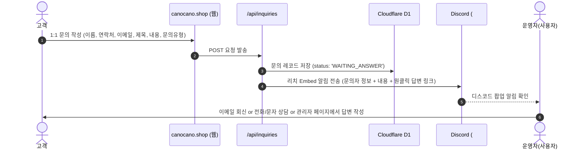
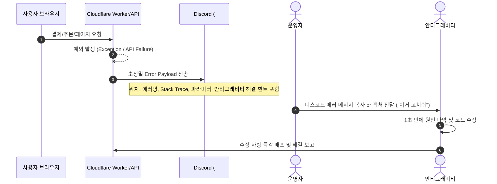

# [상세 실전 명세서 & 가이드] 카노카노(canocano.shop) 마이그레이션 및 자동화 운영 체계

본 문서는 **카노카노(`canocano.shop`)** 웹사이트를 아임웹(imweb)에서 **Cloudflare + 토스페이먼츠 + 디스코드 관제 + 안티그래비티 Agent CMS** 체계로 완벽하게 마이그레이션하기 위한 **상세 행동 매뉴얼(SOP)** 및 **시스템 설계 명세서**입니다.

---

## 1. 사전 확인 질문 (User Confirmation Questions)

작업 착수 전 확인이 필요한 핵심 4가지 항목입니다:

1. **도메인(`canocano.shop`) 구매 등록 대행업체**:
   - 현재 도메인을 어디서 구매하셨나요? (예: 아임웹 부가서비스, 가비아, 후이즈, 호스팅케이알 등)
   - *이유: Cloudflare의 네임서버로 변경할 때 해당 등록업체 사이트에서 네임서버 2줄을 수정해야 합니다.*
2. **아임웹 데이터 이관 방식**:
   - 상품 데이터는 안티그래비티가 현재 사이트(`canocano.shop`)에서 이미지/가격/상세페이지를 고화질로 자동 스크래핑 및 복원할 수 있습니다. 추가로 아임웹 관리자에서 [상품 엑셀 다운로드]를 받아주시면 옵션 및 재고까지 100% 일치시킬 수 있습니다.
3. **토스페이먼츠(Toss Payments) 준비 상태**:
   - 토스페이먼츠 개발자센터(developers.tosspayments.com) 계정이 이미 있으신가요? (없으시다면 초기 개발 및 테스트는 안티그래비티가 테스트 키로 완벽히 구축해 두고, 추후 키만 교체하시면 됩니다.)
4. **고객 문의(CS) 응대 선호 방식**:
   - 웹사이트 1:1 문의 폼 접수 시 -> 디스코드로 알림 전송 -> 고객에게 이메일/문자 회신
   - 웹사이트 우측 하단 카카오톡 1:1 상담 채널 버튼 연동 병행 여부

---

## 2. 관리자 조작 매뉴얼 (Step-by-Step UI 조작 가이드)

### 2.1. 아임웹(`canocano.imweb.me/admin`)에서 해야 할 일 (10분 소요)

#### [STEP 1] 상품 데이터 엑셀 백업 (옵션)
1. 아임웹 관리자 페이지 접속 (`https://canocano.imweb.me/admin`)
2. 좌측 메뉴에서 **[쇼핑]** > **[상품관리]** 클릭
3. 우측 상단의 **[엑셀 다운로드]** 버튼 클릭
4. 다운로드된 `.xlsx` 또는 `.csv` 파일을 `/Users/canocano/Documents/Canocano` 디렉토리에 넣어두시면 안티그래비티가 1초 만에 DB로 이관합니다.

#### [STEP 2] 기존 주문/회원 내역 백업 (필요 시)
1. 좌측 메뉴에서 **[쇼핑]** > **[주문관리]** 클릭
2. 기간을 [전체]로 설정 후 **[엑셀 다운로드]** 클릭
3. 좌측 메뉴에서 **[사용자관리]** > **[회원목록]** 클릭 후 **[엑셀 다운로드]** 클릭

#### [STEP 3] 도메인 연결 정보 확인
1. 좌측 메뉴에서 **[환경설정]** > **[도메인]** 클릭
2. 현재 `canocano.shop`이 [대표 도메인]으로 설정되어 있는지 확인
3. 도메인 구입처 확인 (아임웹 구매인지, 외부 등록업체인지 확인)

---

### 2.2. 디스코드(Discord) 데스크탑 앱에서 해야 할 일 (5분 소요)

디스코드 서버 내에 관제 및 알림용 전용 채널 4개를 생성하고 웹훅 URL을 발급합니다.

#### [STEP 1] 서버 및 채널 생성
1. 디스코드 앱 실행 -> 좌측 서버 목록에서 `+` 버튼을 눌러 **[직접 만들기]** > **[나와 친구들을 위한 서버]** (서버명: `카노카노 관제센터`)
2. 텍스트 채널 `+` 버튼을 눌러 다음 4개 채널을 각각 생성:
   - 🚨 **`error-logs`** (또는 `#오류-보고`)
   - 💰 **`orders`** (또는 `#주문-결제-내역`)
   - 💬 **`inquiries`** (또는 `#고객-문의`)
   - 📦 **`inventory`** (또는 `#상품-재고-관리`)

#### [STEP 2] 채널별 웹훅(Webhook) URL 발급
1. 각 채널명 우측의 ⚙️ **[채널 설정(톱니바퀴)]** 클릭
2. 좌측 탭에서 **[연동(Integrations)]** > **[웹후크(Webhooks)]** 클릭
3. **[새 웹후크 만들기]** 클릭 (봇 이름 설정: 예: `카노봇 - 오류`, `카노봇 - 주문`)
4. **[웹후크 URL 복사]** 버튼 클릭
5. 4개 채널의 복사된 Webhook URL을 안티그래비티에게 전달하거나 `.env`에 입력.

---

### 2.3. Cloudflare에서 해야 할 일 (10분 소요)

#### [STEP 1] 도메인 추가 및 네임서버 등록
1. [Cloudflare 대시보드](https://dash.cloudflare.com) 접속 및 로그인
2. 상단/우측의 **[+ 사이트 추가]** (Add a Site) 클릭
3. 도메인명 입력: `canocano.shop` 입력 후 [계속] 클릭
4. 요금제 선택: **Free ($0)** 플랜 선택 후 [계속]
5. 기존 DNS 레코드 자동 검색 완료 후 [계속]
6. 화면에 표시되는 **Cloudflare 지정 네임서버 2개** (예: `ns1.cloudflare.com`, `ns2.cloudflare.com`)를 복사.
7. 도메인 구매 사이트(가비아/아임웹 등)의 도메인 관리 메뉴에서 기존 네임서버를 Cloudflare 네임서버 2개로 교체.

#### [STEP 2] Cloudflare Pages 프로젝트 생성 & 자동 배포
1. Cloudflare 좌측 메뉴에서 **[Workers & Pages]** > **[Create Application]** > **[Pages]** 클릭
2. Git 저장소(GitHub) 연결 또는 Direct Upload 설정
3. 안티그래비티가 작성한 코드가 빌드되어 `canocano.shop`으로 즉각 배포됩니다.

---

### 2.4. 토스페이먼츠(Toss Payments)에서 해야 할 일 (5분 소요)

1. [토스페이먼츠 개발자센터](https://developers.tosspayments.com) 로그인
2. 상단 메뉴에서 **[API 키]** 클릭
3. **테스트 API 키**:
   - `클라이언트 키 (Client Key)`: `test_ck_...`
   - `시크릿 키 (Secret Key)`: `test_sk_...`
4. 안티그래비티에게 전달하면 즉시 결제 연동 테스트가 가동되며, 정식 계약 후 **라이브 API 키**로 교체만 하면 실결제 상용 오픈이 완료됩니다.

---

## 3. 고객 문의(CS) & 주문 처리 세부 워크플로우 명세

### 3.1. 고객 문의(CS) 프로세스 상세
고객이 웹사이트에서 문의를 남기면 발생하는 전 과정입니다.



#### 디스코드 `#고객-문의` 알림 포맷
- **제목**: 💌 [신규 고객 문의] 상품 문의가 접수되었습니다.
- **작성자**: 홍길동 (010-1234-5678 / customer@email.com)
- **문의 유형**: `[배송/제작 기간 문의]`
- **제목**: 삼각 우드 하우스 배송 언제 되나요?
- **내용**: 이번 주 금요일까지 받아볼 수 있을지 궁금합니다.
- **조치 옵션**: `[이메일로 바로 답장하기]` 버튼 링크 제공

---

### 3.2. 실시간 오류 감지 및 "Zero-Context 안티그래비티 디버깅" 프로세스

고객 또는 관리자가 사이트 이용 중 에러를 겪었을 때의 처리 방식입니다.



#### 디스코드 `#오류-보고` Embed 상세 구조
```json
{
  "embeds": [
    {
      "title": "🚨 [사이트 런타임 오류 감지] Canocano Production Error",
      "color": 15158332,
      "fields": [
        { "name": "📍 발생 지점", "value": "`POST /api/payments/confirm`", "inline": true },
        { "name": "⏱ 발생 시각", "value": "2026-08-17 15:52:00 KST", "inline": true },
        { "name": "⚠️ 오류 내용", "value": "`PROVIDER_ERROR: 잔액 부족 또는 카드 한도 초과`", "inline": false },
        { "name": "👤 사용자 정보", "value": "주문번호 `ORD-20260817-001` / IP: `121.134.xx.xx` / Safari Mobile", "inline": false },
        { "name": "📋 Stack Trace", "value": "```ts\nTossPaymentError: PROVIDER_ERROR\n    at confirmTossPayment (src/lib/toss.ts:54:12)\n    at async POST (src/app/api/payments/confirm/route.ts:24:9)\n```", "inline": false },
        { "name": "💡 안티그래비티 원클릭 해결 가이드", "value": "토스페이먼츠 PG 오류 응답 코드입니다. 결제 실패 안내 팝업을 사용자 브라우저에 띄우고 장바구니를 복구하도록 처리되어 있습니다.", "inline": false }
      ],
      "footer": { "text": "Canocano Sentryless Agent Observer" }
    }
  ]
}
```

---

### 3.3. 주문 및 결제 완료 프로세스

- 고객이 토스 결제를 마치면 즉시:
  1. D1 DB에 주문 상태 `PAID` 업데이트 및 재고 차감.
  2. 고객 브라우저에 깔끔한 **주문 완료 영수증 페이지** 렌더링.
  3. 디스코드 **`#주문-결제-내역`** 채널에 다음과 같이 알림:
     - 🛍️ **[주문 완료]** 주문번호: `ORD-20260817-102`
     - **주문자**: 이형지 (010-xxxx-xxxx)
     - **배송지**: 경기도 파주시 탄현면 국원말길 38, 101호
     - **상품**: 베베블 우드 테이블 2size (1개) - ₩22,000 / 크로스 우드 테이블 (1개) - ₩22,000
     - **총 결제금액**: ₩44,000 (토스페이 간편결제 승인)

---

## 4. 안티그래비티 주도 운영 (Agent-Driven CMS) 실제 사용 예시

쇼핑몰을 운영하시면서 안티그래비티에게 자연어로 다음과 같이 말씀하시면 됩니다:

1. **상품 등록/수정**:
   > *"새로운 신제품 '미니 캣폴' 추가해줘. 가격은 89,000원이고 옵션은 베이지/그레이야. 이미지는 바탕화면 폴더에 있어."*
   -> 안티그래비티가 DB에 즉시 등록하고 배포.
2. **가격 할인/프로모션**:
   > *"베베블 우드 테이블 20% 할인 이벤트 적용해줘."*
   -> 안티그래비티가 원가와 할인가격을 업데이트.
3. **오류 해결**:
   > *(디스코드에 뜬 에러 캡처나 복사본을 붙여넣으며)* *"이 오류 고쳐줘."*
   -> 안티그래비티가 해당 파일의 버그를 즉시 수정 후 빌드/배포.
4. **정산 및 매출 조회**:
   > *"이번 주 들어온 주문 내역이랑 총매출 정리해줘."*
   -> D1 데이터베이스에서 즉시 조회하여 테이블 보고서 출력.

---

## 5. 단계별 실행 계획

1. **사용자 확인**: 상단 1번의 4가지 질문 답변 확인.
2. **Phase 1: 코드베이스 구축 & 아임웹 데이터 마이그레이션**:
   - Next.js 14 풀스택 쇼핑몰 앱 생성 (`/Users/canocano/Documents/Canocano`).
   - 기존 `canocano.shop`의 5개 상품 및 디자인/브랜드 에셋 완벽 복원.
3. **Phase 2: 디스코드 웹훅 연동 & 에러 리포터 탑재**:
   - 4개 채널 웹훅 발송 모듈 구현 및 에러 자동 캡처 시스템 구축.
4. **Phase 3: 토스페이먼츠 결제 연동**:
   - 토스 결제 위젯 + 주문 생성 + 결제 승인 API 구현.
5. **Phase 4: 고객 문의 폼 & 관리자 API 구현**:
   - 1:1 문의 작성 및 디스코드 전송, 카카오톡 상담 버튼 연동.
6. **Phase 5: Cloudflare 배포 & 도메인 DNS 전환**:
   - Cloudflare Pages 배포 및 `canocano.shop` 연결.
